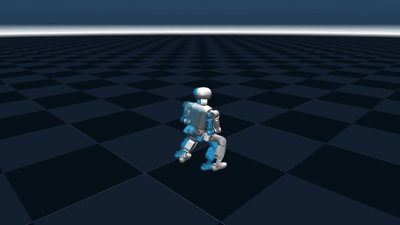
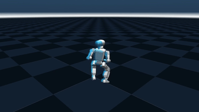
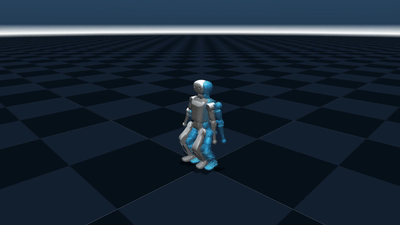
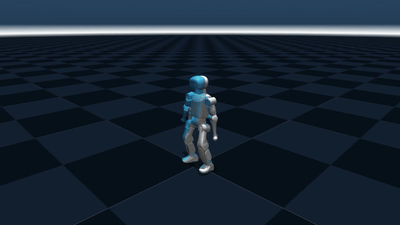
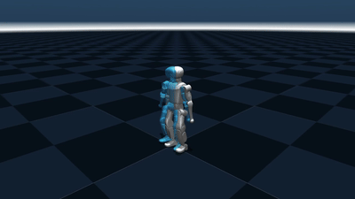
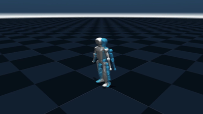
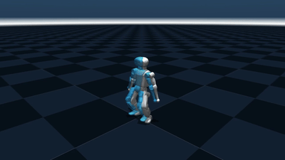
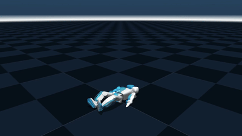

# ScaleBFM-K1

22-DoF K1 motion tracking with ScaleBFM and SuperMimic-style world-model training,
based on [ScaleBFM_Plus](https://github.com/Hxxxz0/ScaleBFM_Plus).

## Demos

Simulated policy execution, 42k checkpoint, seed 42. Blue is the global reference;
no trajectory correction. Click each preview for its independent, text-free MP4.

| | |
|---|---|
| **Kick and recovery**<br>[](docs/media/01_kick.mp4) | **Fighting**<br>[](docs/media/02_fighting.mp4) |
| **Charleston**<br>[](docs/media/05_charleston.mp4) | **Clap step**<br>[](docs/media/09_clap_step.mp4) |
| **Macarena**<br>[](docs/media/12_macarena.mp4) | **Squat**<br>[](docs/media/14_squat.mp4) |
| **Titan Run**<br>[](docs/media/15_titan_run.mp4) | **Supine get-up**<br>[](docs/media/16_supine_getup.mp4) |

BONES demos use complete clips. The two LAFAN fighting demos use independently
initialized windows; they do not establish full-length tracking success.
[Sources and intervals](docs/media/manifest.json). These are selected simulation
results, not hardware validation.

## Train

Follow [setup and data preparation](docs/k1/README.md), then launch with a packed
BONES-SEED + LAFAN1 K1 library:

```bash
K1_DATA_DIR=/path/to/combined_exact bash scripts/k1/launch_a10.sh
```

Defaults: 8 GPUs, 512 environments/GPU, seed 42, 320k updates.
Training, playback and export entry points are under `scripts/pretrain/`;
K1 data and asset tools are under `scripts/k1/`.

## Layout

- `scripts/`: training, evaluation, export and K1 data tools.
- `source/scaletrack/`: robot assets, tasks and simulation environments.
- `source/my_rsl_rl/`: policy and world-model training.
- `docs/`: setup, data provenance and demos.

## Acknowledgements

[ScaleBFM](https://github.com/zengweishuai/ScaleBFM),
[ScaleBFM_Plus](https://github.com/Hxxxz0/ScaleBFM_Plus),
[SuperMimic](https://github.com/KunYing-Lee/SuperMimic), IsaacLab and RSL-RL.
Upstream attribution and bundled third-party license notices are retained.
